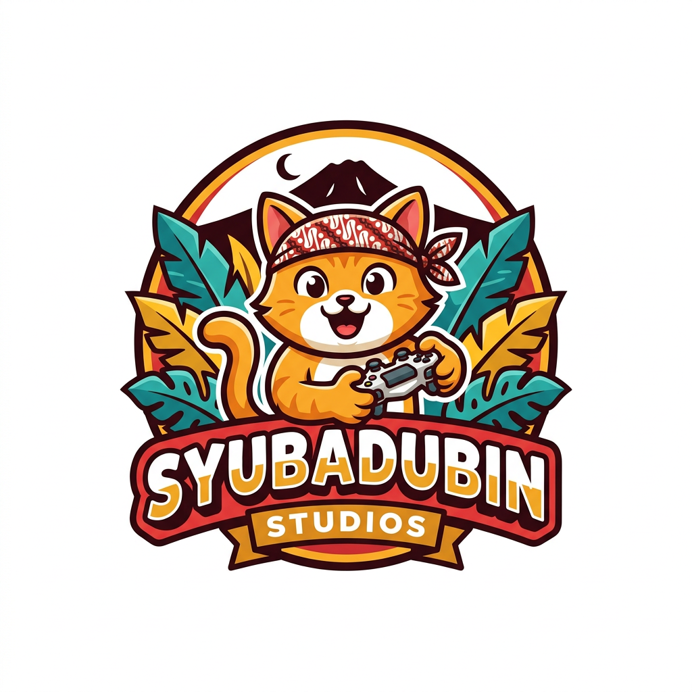

# 🎮 Syubadubin

### Studio Game Indie dari Bogor 🇮🇩

*Dibuat dengan imajinasi, dimainkan dengan seru.*

---

## 👋 Tentang Kami

**Syubadubin** adalah studio game indie baru dari **Bogor, Jawa Barat**. Studio ini didirikan oleh **Ariana Mischa Fadhila**, seorang game creator berumur **7 tahun**. 🌟

Kami percaya bahwa ide game seru bisa datang dari siapa saja, di umur berapa saja. Dari imajinasi anak-anak, kami membuat game dengan cerita, suasana, dan karakter yang dekat dengan kehidupan sehari-hari di Indonesia.

Semua game kami dibuat dengan **.NET 10 (C#)**, bisa dimainkan di **Windows, Linux, dan macOS**, dan tersedia dalam **Bahasa Indonesia dan Inggris**.

---

## 🎮 Game Kami

| Game | Genre | Rilis terbaru |
|---|---|---|
| 🥊 [Djancoeg Tournament](https://github.com/SyubadubinStudios/DjancoegTournament) | Arena tembak-tembakan multiplayer | [v2.2.0](https://github.com/SyubadubinStudios/DjancoegTournament/releases/latest) |
| 🍳 [Happy Cooking](https://github.com/SyubadubinStudios/HappyCooking) | Petualangan memasak 3D untuk anak | [v1.0.0](https://github.com/SyubadubinStudios/HappyCooking/releases/latest) |
| 🥋 [Tarkam Arena](https://github.com/SyubadubinStudios/TarkamArena) | Game pertarungan 3D | [v0.2.2](https://github.com/SyubadubinStudios/TarkamArena/releases/latest) |
| 🎣 [Nusantara Fishing Madness](https://github.com/SyubadubinStudios/NusantaraFishingMadness) | Petualangan memancing 3D | [v0.3.0-preview.3](https://github.com/SyubadubinStudios/NusantaraFishingMadness/releases) (preview) |
| 🦸 [Si Jenggo](https://github.com/SyubadubinStudios/SiJenggo) | Beat 'em up 3D side-scrolling | [v0.1.1](https://github.com/SyubadubinStudios/SiJenggo/releases/latest) |
| 🏡 [Our Happy Home](https://github.com/SyubadubinStudios/OurHappyHome) | Simulasi kehidupan keluarga | [v1.4.0](https://github.com/SyubadubinStudios/OurHappyHome/releases/latest) |
| 🧟 [Bertahan!](https://github.com/SyubadubinStudios/bertahan) | Survival zombie third person | [v1.0.1](https://github.com/SyubadubinStudios/bertahan/releases/latest) |

---

## 🥊 Djancoeg Tournament

> *Arena pertarungan paling kacau se-Indonesia.*

Game tembak-tembakan multiplayer dengan sudut pandang orang pertama dan ketiga. Tokoh wayang, kang ojol, pocong, dan kucing oren beradu di pasar malam.

- 🗺️ Kampanye **Tur Nusantara**: 20 tahap di Jawa, Sumatra, Kalimantan, Sulawesi, dan Nusa Tenggara, dengan 6 bos dan mode co-op
- 🎯 Mode *Tawuran Bebas*, *Perang Kampung*, *Raja Warung*, *Rebutan Gorengan*, dan *Panjat Pinang*
- 🧑‍🤝‍🧑 17 petarung, 10 senjata kocak (dari raket nyamuk sampai kipas sate), dan 7 arena
- 🌐 Sampai 32 pemain lewat LAN, online, atau server sendiri
- 🛠️ Editor level di dalam game dan Workshop untuk mod

---

## 🍳 Happy Cooking

> *Petualangan memasak 3D untuk anak.*

Game memasak penuh warna untuk anak usia 5–12 tahun. Berlayar ke enam pulau kuliner, dari Pulau Nusantara sampai Negeri Ajaib Hidangan Penutup.

- 🍲 33 resep dari 6 pulau, dimasak lewat mini-game memotong, memanggang, menuang, mengaduk, dan menghias
- 🏪 Restoran sendiri, 🌱 kebun dengan 12 tanaman, 🐟 memancing 10 jenis ikan, 🐼 8 hewan peliharaan
- 📜 18 misi cerita, 14 trofi, dan acara musiman seperti lomba masak 17 Agustus
- 📚 Fakta seru di setiap masakan
- 📱 Tersedia juga untuk Android dan iOS

---

## 🥋 Tarkam Arena

> *Dari pasar becek sampai dunia gaib, semua petarung punya cerita.*

Game pertarungan 3D dari dunia *tarkam*, turnamen antar kampung di Indonesia.

- 👊 51 petarung: profesi, makhluk gaib (Kuntilanak, Pocong, Leak, Reog…), satwa Nusantara, dan legenda rahasia seperti Gatotkaca, Si Pitung, dan Nyi Roro Kidul
- ⚙️ Sistem fighting game sungguhan: kombo, air combo, bantingan, parry, dan mode Rage
- 🌪️ Tiga **jurus pamungkas** untuk setiap petarung
- 🏯 Arena Candi Borobudur, Gunung Bromo, Pantai Selatan, Pasar Becek, dan lainnya
- 🏆 Mode cerita, turnamen, 2 lawan 2, dan online

---

## 🎣 Nusantara Fishing Madness

> *Petualangan memancing seru keliling Nusantara.*

Berlayar keliling kepulauan Indonesia, jelajahi pulau di darat dan di air, lalu tangkap ikan langka dan bos daerah.

- 🗺️ 14 wilayah dengan arus, kedalaman, dan bahaya yang berbeda
- 🐟 44 tangkapan dan 14 bos daerah
- 🧑 11 karakter dengan kemampuan khusus dan 6 tingkat perahu
- 🌊 Air, pulau, satwa, cuaca, dan siang-malam yang hidup
- 🤝 Co-op online

🚧 **Masih versi preview.**

---

## 🦸 Si Jenggo — Preman Berhati Malaikat

> *Ketika preman terakhir memilih melindungi rakyat, seluruh Garuda Hitam harus tumbang.*

Beat 'em up 3D side-scrolling berlatar Indonesia.

- 🥊 4 petarung: Si Jenggo, Bima, Mbak Rani, dan Ustad Ucup
- 📖 7 bab, dari gang kumuh Jakarta sampai kota masa depan, masing-masing dengan bos 3 fase
- 🔥 Meteran **Rage Nusantara** dan jurus daerah (Silat Betawi, Debus Banten, Silat Minang…)
- 🗡️ Senjata tradisional: golok, keris, kujang, celurit, rencong, dan mandau
- 🤝 Co-op lokal, online, atau bersama partner AI
- 📱 Tersedia juga untuk Android

---

## 🏡 Our Happy Home

> *Setiap hari adalah cerita. Setiap keluarga adalah petualangan.*

Game simulasi kehidupan keluarga 3D. Bangun dan hias rumah, jalani hari bersama Ayah, Ibu, Kak Nara, Raka, dan Dinda, jelajahi kota, dan pastikan **tidak ada yang tertinggal** saat keadaan darurat.

- 👨‍👩‍👧‍👦 Lima anggota keluarga yang hidup sendiri, lengkap dengan kebutuhan, suasana hati, dan hubungan
- 🏠 Bangun rumah dari *Rumah Kecil* sampai rumah dua lantai, dengan 40+ perabot interaktif
- 🍳 20 resep, termasuk mi goreng, gado-gado, dan martabak manis
- ⛈️ Cuaca dinamis, kejadian acak, dan keadaan darurat dengan sistem penyelamatan
- 🏙️ Kota yang bisa dijelajahi: sekolah, supermarket, klinik, pantai, perkemahan, dan festival kota

---

## 🧟 Bertahan!

> *Bertahanlah. Lindungi keluargamu. Jangan biarkan kampung ini jatuh.*

Game **survival melawan zombie** dengan latar **perkampungan Indonesia** dan sudut pandang **third person**. Tidak ada kota futuristik atau markas militer. Yang ada sawah, pasar lama, kuburan tua, dan rumah-rumah warga yang kamu kenal.

| Karakter | Peran |
|----------|-------|
| 👨 **Bapak** | Kepala keluarga |
| 👩 **Ibu** | Penjaga rumah |
| 🧑 **Kakak** | Anak yang lebih tua |
| 🧒 **Ade** | Si kecil yang lincah |
| 👴 **Kake** | Kakek |
| 👵 **Nene** | Nenek |

- 🔧 Senjata serba ada: pentungan, sapu lidi, wajan, bambu runcing, linggis, kampak, pacul, senapan tua, sampai bom molotov
- 🏘️ 10 level, dari Gerbang Kampung sampai Candi Terlarang
- 👹 8 bos dari cerita rakyat, termasuk Genderuwo, Kuntilanak, dan Dukun Zombi
- 🧟 13 jenis zombie dan 6 musuh tambahan
- 🐔 Kampung yang ramai dengan warga dan hewan

---

## 📍 Dari Bogor untuk Dunia

Syubadubin lahir di Bogor dan bangga membawa budaya serta suasana Indonesia ke dalam game.

---

**Syubadubin** · Bogor, Indonesia · Game Studio Indie

*Dibuat dengan imajinasi, dimainkan dengan seru.* 🎮🇮🇩

