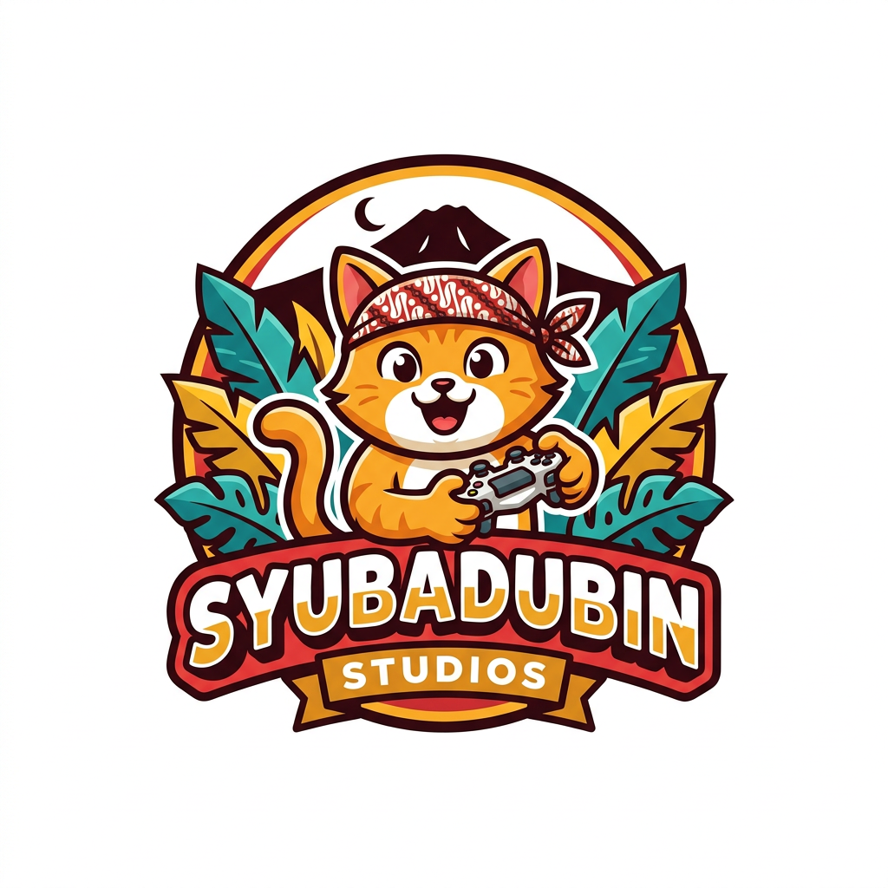
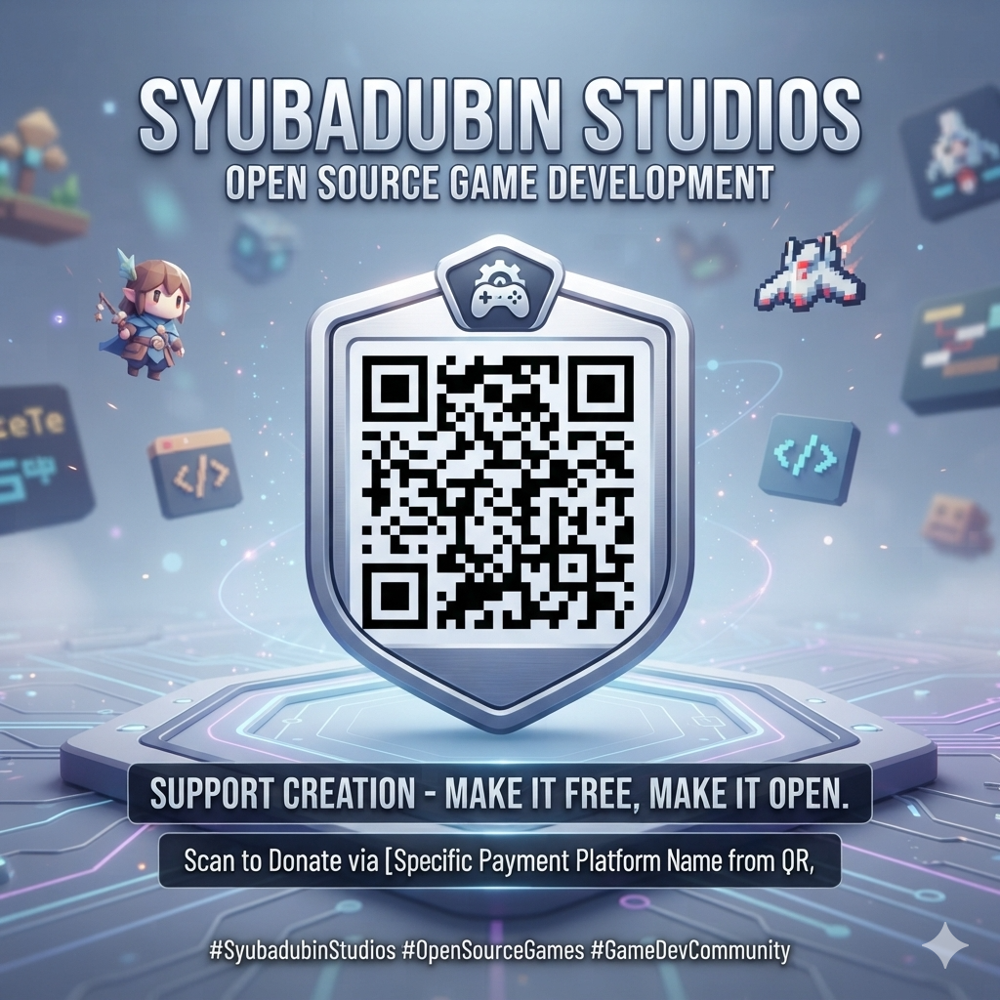

# 🎮 Syubadubin Studios

### Indie Game Studio from Bogor, Indonesia 🇮🇩

**Created with imagination, built for fun.**

---

## 👋 About Us

Syubadubin Studios is a young indie game studio based in Bogor, West Java, Indonesia.

Founded by **Ariana Mischa Fadhila**, Syubadubin believes that great game ideas can come from anyone, regardless of age. Inspired by Indonesian culture, daily life, local stories, and childhood imagination, we create games that are fun, memorable, and uniquely Indonesian.

Our mission is to bring Indonesian-inspired experiences to players around the world.

All our games are built with **.NET 10 (C#)**, run on **Windows, Linux and macOS**, and are playable in **English and Bahasa Indonesia**.

---

# 🎮 Our Games

| Game | Genre | Latest release |
|---|---|---|
| 🥊 [Djancoeg Tournament](#-djancoeg-tournament) | Multiplayer arena shooter (FPS/TPS) | [v2.2.0](https://github.com/SyubadubinStudios/DjancoegTournament/releases/latest) |
| 🍳 [Happy Cooking](#-happy-cooking) | 3D cooking adventure for kids | [v1.0.0](https://github.com/SyubadubinStudios/HappyCooking/releases/latest) |
| 🥋 [Tarkam Arena](#-tarkam-arena) | 3D fighting game | [v0.2.2](https://github.com/SyubadubinStudios/TarkamArena/releases/latest) |
| 🎣 [Nusantara Fishing Madness](#-nusantara-fishing-madness) | 3D fishing adventure | [v0.3.0-preview.3](https://github.com/SyubadubinStudios/NusantaraFishingMadness/releases) (preview) |
| 🦸 [Si Jenggo](#-si-jenggo--preman-berhati-malaikat) | 3D side-scrolling beat 'em up | [v0.1.1](https://github.com/SyubadubinStudios/SiJenggo/releases/latest) |
| 🏡 [Our Happy Home](#-our-happy-home) | Family life simulation | [v1.4.0](https://github.com/SyubadubinStudios/OurHappyHome/releases/latest) |
| 🧟 [Bertahan!](#-bertahan) | Third-person zombie survival | [v1.0.1](https://github.com/SyubadubinStudios/bertahan/releases/latest) |

---

## 🥊 Djancoeg Tournament

**Ultimate Indonesian Chaos Battle Arena.**

A first- and third-person multiplayer arena shooter where wayang heroes, ride-hailing drivers, pocong and orange cats settle things at the night market.

### Features

- 🗺️ **Tur Nusantara** campaign: 20 stages across Java, Sumatra, Borneo, Sulawesi and Nusa Tenggara, 6 boss fights, co-op over LAN or online
- 🎯 5 modes: *Tawuran Bebas*, *Perang Kampung*, *Raja Warung*, *Rebutan Gorengan*, *Panjat Pinang*
- 🧑‍🤝‍🧑 17 fighters, 10 absurd weapons (from a mosquito racket to a satay fan) and 7 arenas
- 🌐 Up to 32 players: bots, LAN, online with a master server, or a dedicated server
- 🧱 Destructible stalls and benches, ragdolls, and random Arena Creeps like Buto Ijo
- 🛠️ In-game level editor, JSON modding and an online Workshop

👉 [Repository](https://github.com/SyubadubinStudios/DjancoegTournament) · [Download](https://github.com/SyubadubinStudios/DjancoegTournament/releases/latest)

---

## 🍳 Happy Cooking

**3D Cooking Adventure for Kids.**

A colourful 3D cooking game for children aged 5–12. Sail between six culinary islands, from Nusantara to Dessert Wonderland, and cook through touch-friendly mini-games.

### Features

- 🍲 33 recipes from 6 islands, cooked through chop, heat, pour, stir and decorate mini-games (no dish can be failed)
- 🏪 Run your own restaurant and serve guests
- 🌱 Farm with 12 crops, 🐟 fishing with 10 fish, 🐼 8 pets with special bonuses
- 📜 18 story quests, 14 trophies and seasonal events, including a 17 August cook-off
- 📚 A fun fact about every dish
- 📱 Windows, Linux, macOS, Android and iOS

👉 [Repository](https://github.com/SyubadubinStudios/HappyCooking) · [Download](https://github.com/SyubadubinStudios/HappyCooking/releases/latest)

---

## 🥋 Tarkam Arena

**Legendary Fighting Tournament from Indonesia.**

A 3D fighting game from the world of *tarkam*, the village tournaments of Indonesia, where street workers, spirits, wildlife, satire and legends of the archipelago meet.

### Features

- 👊 51 fighters: professions, mystic creatures (Kuntilanak, Pocong, Leak, Reog…), Nusantara wildlife, and secret legends like Gatotkaca, Si Pitung and Nyi Roro Kidul
- ⚙️ Real fighting-game systems: frame data, combos, air combos, throws, parries and Rage mode
- 🌪️ Three signature moves (*jurus pamungkas*) per fighter, each with its own cut-in
- 🏯 Living arenas: Borobudur, Gunung Bromo, Pantai Selatan, Pasar Becek and more
- 🏆 Story, tournament, 2 vs 2 and online play

👉 [Repository](https://github.com/SyubadubinStudios/TarkamArena) · [Download](https://github.com/SyubadubinStudios/TarkamArena/releases/latest)

---

## 🎣 Nusantara Fishing Madness

**The ultimate Indonesian fishing adventure.**

Sail across the Indonesian archipelago, explore islands on land and water, and land rare catches and regional bosses.

### Features

- 🗺️ 14 regional biomes with currents, depth ecology and hazards
- 🐟 44 catches and 14 regional bosses
- 🧑 11 characters with their own abilities, and 6 boat tiers
- 🌊 Living water, islands, wildlife, weather and day/night cycle
- 🎵 14 original regional music loops
- 🤝 Online co-op

**Status:** 🚧 Preview release

👉 [Repository](https://github.com/SyubadubinStudios/NusantaraFishingMadness) · [Download preview](https://github.com/SyubadubinStudios/NusantaraFishingMadness/releases)

---

## 🦸 Si Jenggo — Preman Berhati Malaikat

***"When the last thug chooses to protect the people, all of Garuda Hitam must fall."***

A 3D side-scrolling beat 'em up set across Indonesia.

### Features

- 🥊 4 fighters: Si Jenggo, Bima, Mbak Rani and Ustad Ucup
- 📖 7 chapters, from the Jakarta slums to a future city, each with a 3-phase boss
- 🔥 *Rage Nusantara* meter and regional fighting styles (Silat Betawi, Debus Banten, Silat Minang…)
- 🗡️ Traditional weapons: golok, keris, kujang, celurit, rencong, mandau
- 🤝 Local and online co-op, or play with an AI partner
- 🎮 Story, Arcade, Survival, Boss Rush and Challenges, on desktop and Android

👉 [Repository](https://github.com/SyubadubinStudios/SiJenggo) · [Download](https://github.com/SyubadubinStudios/SiJenggo/releases/latest)

---

## 🏡 Our Happy Home

***"Every day is a story. Every family is an adventure."***

A 3D family life simulation. Build and decorate your home, live each day with Ayah, Ibu, Kak Nara, Raka and Dinda, explore the town, and make sure **nobody gets left behind** when an emergency strikes.

### Features

- 👨‍👩‍👧‍👦 Five family members who live on their own, with needs, moods, skills and relationships
- 🏠 Build from a small house to a two-storey dream home with 40+ interactive furniture pieces
- 🍳 20 recipes, including mi goreng, gado-gado and martabak manis, with a cooking mini-game
- ⛈️ Dynamic weather, random events and emergencies with a rescue system
- 🏙️ An explorable town: school, supermarket, clinic, beach, campground and city festival
- 📸 A family album that captures special moments

👉 [Repository](https://github.com/SyubadubinStudios/OurHappyHome) · [Download](https://github.com/SyubadubinStudios/OurHappyHome/releases/latest)

---

## 🧟 Bertahan!

**Survive. Protect your family. Defend your village.**

A third-person 3D survival game against zombies in an Indonesian village. Pick a brave family member and defend Kampung Damai from waves of funny but dangerous zombies.

### Features

- 👨‍👩‍👧‍👦 Playable family: Bapak, Ibu, Kakak, Ade, Kake and Nene
- ⚔️ Weapons from a broom and a frying pan to bambu runcing, a crowbar, a hoe, an old rifle and Molotov bombs
- 🏘️ 10 levels, from the rice fields and old market to the Forbidden Temple
- 👹 8 folklore bosses, including Genderuwo, Kuntilanak and the Zombie Dukun
- 🧟 13 zombie types and 6 special enemies
- 🐔 A lively village full of residents and animals

👉 [Repository](https://github.com/SyubadubinStudios/bertahan) · [Download](https://github.com/SyubadubinStudios/bertahan/releases/latest)

---

# 🚀 Vision

We want to create games that:

- Celebrate Indonesian culture
- Inspire creativity in young developers
- Deliver memorable experiences for global players
- Show that imagination has no age limit

---

# 📍 From Bogor to the World

Proudly made in Bogor, Indonesia 🇮🇩

Thank you for visiting our repositories and following our journey.

### Happy Gaming! 🎮
